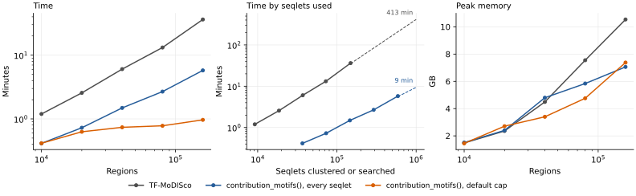

---
hide:
  - toc
---

# Benchmarks

This page holds two benchmarks: the speed and memory use of this package
against the [universalmotif](https://bioconductor.org/packages/universalmotif/)
R package, and [`contribution_motifs()`](#motifs-from-contribution-scores)
against TF-MoDISco, by evidence for the motifs they find and by time and
memory.

Both packages were run on the same inputs with matching parameters. The R
side uses the `_lite` functions where they exist, which run the same
algorithms as this package, and every result was checked against the R
package's. All agree but the clusters of merged motifs: this package leaves
each motif's comparison with itself out of the correction of its q-values,
which the R package includes, and so links a few fewer motifs (288 clusters
to 268).

## Results

This package was 5 to 115 times faster, and usually needed less memory.
Times are medians of five runs, and memory is the peak a task added beyond
its loaded inputs.

| Task | Size | Threads | R | Python | Speed-up | R memory | Python memory |
| --- | ---: | ---: | ---: | ---: | ---: | ---: | ---: |
| Read MEME motifs | 8,790 motifs | 1 | 1.41 s | 0.0351 s | 40x | 26 MB | 22 MB |
| Write MEME motifs | 8,790 motifs | 1 | 1.25 s | 0.039 s | 32x | 103 MB | 21 MB |
| Convert motifs to PWMs | 87,900 motifs | 1 | 5.84 s | 0.113 s | 52x | 203 MB | 81 MB |
| Create a motif from sites | 2,000,000 sites | 1 | 1.6 s | 0.35 s | 5x | 1,055 MB | 306 MB |
| Scan for 50 motifs | 10,000 500 bp sequences | 1 | 35.5 s | 0.308 s | 115x | 23 MB | 12 MB |
| Scan for 50 motifs | 10,000 500 bp sequences | 2 | 18.2 s | 0.166 s | 110x | 21 MB | 13 MB |
| Scan for 400 motifs | 1,000 500 bp sequences | 1 | 35.4 s | 0.494 s | 72x | 29 MB | 105 MB |
| Scan for 400 motifs | 1,000 500 bp sequences | 2 | 18 s | 0.297 s | 61x | 20 MB | 106 MB |
| Scan a chromosome for 10 motifs | 30,427,671 bp | 1 | 24 s | 0.215 s | 112x | 142 MB | 27 MB |
| Scan a chromosome for 10 motifs | 30,427,671 bp | 2 | 12.3 s | 0.12 s | 103x | 140 MB | 24 MB |
| Enrichment of 100 motifs | 1,000 peaks | 1 | 34.8 s | 0.303 s | 115x | 85 MB | 39 MB |
| Enrichment of 100 motifs | 1,000 peaks | 2 | 17.9 s | 0.168 s | 107x | 81 MB | 36 MB |
| Score thresholds for 100 P-values | 879 motifs | 1 | 13.4 s | 0.553 s | 24x | 32 MB | 36 MB |
| Score thresholds for 100 P-values | 879 motifs | 2 | 6.88 s | 0.326 s | 21x | 28 MB | 46 MB |
| Compare all against all, with P-values | 879 motifs | 1 | 47.2 s | 2.05 s | 23x | 391 MB | 291 MB |
| Compare all against all, with P-values | 879 motifs | 2 | 25 s | 1.18 s | 21x | 367 MB | 292 MB |
| Merge similar motifs | 879 motifs | 1 | 47.2 s | 2.02 s | 23x | 392 MB | 272 MB |
| Merge similar motifs | 879 motifs | 2 | 25.2 s | 1.14 s | 22x | 345 MB | 274 MB |
| Shuffle sequences, k = 1 | 100,000 500 bp sequences | 1 | 3.37 s | 0.182 s | 18x | 202 MB | 172 MB |
| Shuffle sequences, k = 1 | 100,000 500 bp sequences | 2 | 2.01 s | 0.113 s | 18x | 208 MB | 118 MB |
| Shuffle sequences, k = 2 | 100,000 500 bp sequences | 1 | 10.3 s | 0.641 s | 16x | 215 MB | 116 MB |
| Shuffle sequences, k = 2 | 100,000 500 bp sequences | 2 | 5.57 s | 0.444 s | 13x | 215 MB | 119 MB |
| Count 1-, 2- and 3-mers | 100,000 500 bp sequences | 1 | 14.3 s | 0.626 s | 23x | 801 MB | 102 MB |
| Count 1-, 2- and 3-mers | 100,000 500 bp sequences | 2 | 11.7 s | 0.389 s | 30x | 820 MB | 102 MB |
| Sequence complexity | 100,000 500 bp sequences | 1 | 24 s | 0.715 s | 34x | 2,623 MB | 590 MB |
| Sequence complexity | 100,000 500 bp sequences | 2 | 21.3 s | 0.504 s | 42x | 2,697 MB | 590 MB |

## Tasks and inputs

| Task | R | Python |
| --- | --- | --- |
| Read and write MEME motifs | `read_meme()`, `write_meme()` | [`read_meme()`][universalmotif.read_meme], [`write_meme()`][universalmotif.write_meme] |
| Convert motifs | `convert_type()` | [`convert_type()`][universalmotif.convert_type] |
| Create a motif | `create_motif()` | [`create_motif()`][universalmotif.create_motif] |
| Scan | `scan_sequences_lite()` | [`scan_sequences()`][universalmotif.scan_sequences] |
| Enrichment | `enrich_motifs_lite()` | [`enrich_motifs()`][universalmotif.enrich_motifs] |
| Score thresholds | `motif_pvalue()` | [`motif_pvalue()`][universalmotif.motif_pvalue] |
| Compare | `compare_motifs_lite()` | [`compare_motifs()`][universalmotif.compare_motifs] |
| Merge | `merge_similar_lite()` | [`merge_similar()`][universalmotif.merge_similar] |
| Shuffle | `shuffle_sequences()` | [`shuffle_sequences()`][universalmotif.shuffle_sequences] |
| Count k-mers | `get_bkg()` | [`get_bkg()`][universalmotif.get_bkg] |
| Complexity | `sequence_complexity()` | [`sequence_complexity()`][universalmotif.sequence_complexity] |

Motifs are from JASPAR 2024 (vertebrates, and plants for the chromosome
scan and enrichment), sequences are random 500 bp windows and chromosome 1
of the *Arabidopsis thaliana* TAIR10 genome, and the peaks are those of
[the ChIP-seq guide](guides/chipseq-workflow.ipynb), tested against
length-matched genomic windows.

## Setup

| | |
| --- | --- |
| Machine | Apple M5 Pro, 48 GB, macOS 26.4.1 |
| R | 4.4.1, universalmotif 1.31.66 |
| Python | 3.12.4, universalmotif 0.6.0, polars 1.44.2 |
| Date | 19 November 2026 |

The scripts are in
[`benchmarks/r_vs_python`](https://github.com/bjmt/universalmotif-py/tree/main/benchmarks/r_vs_python),
along with the raw timings of this run, and its README describes how to run
them.

## Motifs from contribution scores

[`contribution_motifs()`][universalmotif.contribution_motifs] was compared
with TF-MoDISco on the contribution scores of 25 of ENCODE's models: BPNet
models of 16 single factors, chromBPNet models of ATAC-seq in K562, HepG2
and GM12878 cells, and ProCapNet models of PRO-cap in six cell lines.

### How each method was run

| | `contribution_motifs()` | TF-MoDISco, same regions | TF-MoDISco, ENCODE's results |
| --- | --- | --- | --- |
| Version | this package at the `evidence-1` tag of both repositories | modisco-lite 3.0.0 | tfmodisco-lite 2.2.0 |
| Run as | `contribution_motifs()` with its defaults | the `modisco motifs` command with `-n 50000`, and `-w` the width of the regions | the `modisco motifs` command, as ENCODE's archives describe |
| Settings | its defaults | the command's defaults: 2 Leiden runs per clustering, a seqlet FDR of 0.05, seqlet cores of 20 and flanks of 5 | the command's defaults |
| Seqlets searched | at most 50,000 of each sign | at most 50,000 of each sign | at most 1,000,000 of each sign |
| Regions | every peak of each model as a 500 bp window around its summit, with overlapping windows dropped; for ProCapNet, the middle 1,000 bp of every peak | the same windows | all of each model's regions |
| Scores | observed and hypothetical | hypothetical | hypothetical |
| Threads | 2 | 2 | not stated |

Given hypothetical scores, `contribution_motifs()` adds a search of seqlets
rewritten in the letters the model prefers; one run below goes without
them. TF-MoDISco clusters the seqlets in two rounds and then subclusters
each pattern, running each Leiden clustering from several random seeds and
keeping the best. The modisco command uses 2 seeds, where its library's
`TFMoDISco()` uses 50 by default, along with a seqlet FDR of 0.2. Run
through the library with those two defaults on 21,000 of the 30,000
regions of the time comparison below, TF-MoDISco took about ten times as
long. The command is how ENCODE and most users run TF-MoDISco, so it is the
one compared.

### Evidence

No set of motifs is known to be complete for any of these models, so each
motif was checked for evidence of its own rather than against another
method's:

- outside support, either conservation at its sites in the regions (mean
  phyloP of its sites against their flanks, compared with sites of the same
  GC and CpG content) or more ChIP-seq peaks of the factor it is named after,
  in the same cell line, than expected;
- the model's response: planted in 128 shuffled sequences, the motif must
  change the prediction more than copies of it with its columns shuffled,
  and by more than 99% of 200 random motifs of about its width (within 3
  positions) change it, in the same direction.

Each test is held to a Benjamini-Hochberg q-value of 0.01. The bar from
random motifs matters: without it, many motifs passed on the model's
response with effects no larger than a random motif's, and the bar is
matched to width because wider random motifs move the prediction more.
Matching the random motifs by information content instead changed no count
below by more than 2 motifs but one.

Each cell of the table holds two means per model: first the distinct motifs
with evidence of either kind (motifs with CWMs at a cosine of 0.9 or more
counted once), then the motifs with none.

| Run | BPNet | chromBPNet | ProCapNet counts | ProCapNet profile |
| --- | ---: | ---: | ---: | ---: |
| `contribution_motifs()` | 21.9 / 6.8 | 37.3 / 24.0 | 41.5 / 26.7 | 36.0 / 24.3 |
| `contribution_motifs()`, `max_seqlets=None` | 24.4 / 7.8 | 42.0 / 22.3 | 40.0 / 28.3 | 35.7 / 23.8 |
| `contribution_motifs()`, one seqlet pass | 8.4 / 0.7 | 32.0 / 1.7 | 34.2 / 10.0 | 35.8 / 15.3 |
| `contribution_motifs()`, observed scores only | 22.1 / 7.2 | 36.7 / 19.7 | 35.7 / 20.8 | 34.8 / 18.8 |
| TF-MoDISco, same regions | 11.4 / 2.4 | 26.7 / 1.0 | 17.5 / 6.5 | 22.2 / 16.2 |
| TF-MoDISco, ENCODE's results | 10.4 / 1.0 | 45.3 / 4.0 | 24.0 / 6.5 | 22.0 / 16.5 |

The `max_seqlets=None` row searched every seqlet. The one-pass row also
searched every seqlet, called seqlets once and held motifs from the second
search to `min_gain` itself. The observed-only row was run like the first,
without hypothetical scores.

`contribution_motifs()` found more motifs with evidence than TF-MoDISco on
the same regions, on every kind of model and with either kind of scores. It
also found more motifs without evidence. Against ENCODE's TF-MoDISco
results, from all of each model's regions and up to 1,000,000 seqlets, it
found more on BPNet and ProCapNet but fewer on chromBPNet.

The search of idealized seqlets, which hypothetical scores add, helps most
on ProCapNet's counts heads, with 5.8 more motifs with evidence per model,
and little elsewhere, while it adds 4 to 6 more motifs without evidence on
chromBPNet and ProCapNet. The cap of 50,000 seqlets costs a few motifs on
BPNet and chromBPNet against searching every seqlet.

`contribution_motifs()` tends to give several spellings of one site, which
this count favours. Merging the motifs with evidence of the six runs at a
cosine of 0.8 instead, the share of them each run found is:

| Run | BPNet | chromBPNet | ProCapNet counts | ProCapNet profile |
| --- | ---: | ---: | ---: | ---: |
| `contribution_motifs()` | 0.52 | 0.49 | 0.52 | 0.44 |
| `contribution_motifs()`, `max_seqlets=None` | 0.54 | 0.56 | 0.53 | 0.50 |
| `contribution_motifs()`, one seqlet pass | 0.25 | 0.39 | 0.46 | 0.40 |
| `contribution_motifs()`, observed scores only | 0.50 | 0.46 | 0.49 | 0.46 |
| TF-MoDISco, same regions | 0.44 | 0.45 | 0.39 | 0.36 |
| TF-MoDISco, ENCODE's results | 0.40 | 0.64 | 0.49 | 0.37 |

The motifs without evidence are an upper bound on noise, since motifs of
factors without ChIP-seq data, or whose sites are not conserved, land there
too. Split by the kind of evidence, the second seqlet pass, compared with
the one-pass run that also searched every seqlet, adds 5.7 to 7.4 motifs
with outside support per model on BPNet, chromBPNet and ProCapNet's counts heads,
and almost none on its profile heads, at the cost of 7 to 21 more motifs
without evidence. Here each cell holds first the motifs with outside
support, with or without a response from the model, then the motifs with
the model's response only, not merged:

| Run | BPNet | chromBPNet | ProCapNet counts | ProCapNet profile |
| --- | ---: | ---: | ---: | ---: |
| `contribution_motifs()` | 10.8 / 12.1 | 27.7 / 10.7 | 32.3 / 9.8 | 30.0 / 6.3 |
| `contribution_motifs()`, `max_seqlets=None` | 11.7 / 13.4 | 26.7 / 15.3 | 31.7 / 9.2 | 29.7 / 6.2 |
| `contribution_motifs()`, one seqlet pass | 4.9 / 3.9 | 21.0 / 11.3 | 24.3 / 10.5 | 29.0 / 6.8 |
| `contribution_motifs()`, observed scores only | 10.9 / 12.4 | 25.7 / 11.7 | 27.2 / 8.8 | 30.0 / 5.2 |
| TF-MoDISco, same regions | 6.5 / 5.1 | 19.3 / 7.7 | 14.7 / 2.8 | 16.7 / 5.5 |
| TF-MoDISco, ENCODE's results | 5.6 / 5.1 | 30.0 / 17.0 | 19.7 / 5.0 | 19.8 / 2.3 |

Only positive motifs are compared. The evidence for negative motifs, almost
all of it the model's response, depends heavily on how the random motifs
are matched, so it is left out.

Every row of these tables was run, and every motif in them checked, at the
`evidence-1` tag, and `contribution_motifs()` run again on four heads gave
the same verdicts. The harness, with the per-model results the tables were
summarized from, is in
[`benchmarks/contribution_motifs_evidence`](https://github.com/bjmt/universalmotif-py/tree/main/benchmarks/contribution_motifs_evidence).

On scores shuffled across and within regions, with nothing to find, an
earlier development build of `contribution_motifs()`, with two seqlet passes
as now, gave 2 motifs over 7 heads of 6 models, where 0.6.0 gave up to 48
per head.

### Time and memory

These runs were on the machine of the [setup](#setup) above, each method in
a process of its own with 2 threads. Each was run once, and its time and
peak memory are those of the whole process from `/usr/bin/time -l`, with the
inputs loaded. TF-MoDISco forks worker processes, so its memory was also
sampled over all of them, and its peak was no higher than that of its main
process. Memory is in units of 109 bytes, and on the large sets
its peak varies by about a gigabyte from one run to the next. TF-MoDISco
also clusters its negative seqlets, while `contribution_motifs()` searched
only positive ones; on these regions TF-MoDISco called about one negative
seqlet for every hundred positive ones.

On 30,000 regions of 500 bp drawn at random from those of the chromBPNet
model of K562, with the methods run as above, `contribution_motifs()` took
a ninth of TF-MoDISco's time, or a seventh with its search of idealized
seqlets:

| Run | Time | Memory |
| --- | ---: | ---: |
| TF-MoDISco | 254 s | 3.6 GB |
| `contribution_motifs()`, observed scores only | 27.1 s | 3.2 GB |
| `contribution_motifs()`, observed and hypothetical scores | 38.0 s | 2.7 GB |

To see how each method grows with the data, both were run on nested random
samples of 10,000 to 160,000 of the K562 regions. TF-MoDISco was run as
ENCODE ran it, with up to 1,000,000 seqlets of each sign, and
`contribution_motifs()` with hypothetical scores, both with every seqlet and
with its default cap. TF-MoDISco calls fewer seqlets than
`contribution_motifs()`, about 0.9 per region against 3.7, so the middle
panel gives time against the seqlets each method clustered or searched:

TF-MoDISco's time grew a little faster than its seqlets, by a power of
about 1.3 over the larger samples, and that of `contribution_motifs()` about
in proportion to its seqlets. Carried on to 1,000,000 seqlets, ENCODE's cap,
that comes to about 7 hours for TF-MoDISco and 9 minutes for
`contribution_motifs()`. TF-MoDISco's growth was still steepening at the
largest sample, so its figure may well be low. With its default cap of
50,000 seqlets, `contribution_motifs()` took under a minute at every size.
Memory grew with the regions for all three runs, much of it the scores
themselves:

| Regions | TF-MoDISco | `contribution_motifs()`, every seqlet | `contribution_motifs()`, default cap |
| ---: | ---: | ---: | ---: |
| 10,000 | 72 s, 1.5 GB, 9,192 seqlets | 25 s, 1.5 GB, 36,725 seqlets | 25 s, 1.5 GB |
| 20,000 | 154 s, 2.4 GB, 18,564 seqlets | 44 s, 2.4 GB, 73,074 seqlets | 38 s, 2.7 GB |
| 40,000 | 362 s, 4.5 GB, 37,078 seqlets | 89 s, 4.8 GB, 145,841 seqlets | 44 s, 3.4 GB |
| 80,000 | 791 s, 7.6 GB, 72,501 seqlets | 161 s, 5.8 GB, 291,020 seqlets | 47 s, 4.8 GB |
| 160,000 | 2,176 s, 10.5 GB, 148,788 seqlets | 346 s, 7.1 GB, 588,412 seqlets | 58 s, 7.4 GB |

By default `contribution_motifs()` searches at most 50,000 seqlets of each
sign, a random sample of them when there are more. On every region of the
chromBPNet models, which hold about 200,000 to 700,000 seqlets, the sample
made the search 2.4 to 8 times faster and used less memory, here with
observed scores only:

| Model | Regions | Seqlets searched | Time, sample | Time, every seqlet | Memory, sample | Memory, every seqlet |
| --- | ---: | ---: | ---: | ---: | ---: | ---: |
| chromBPNet K562, counts | 186,881 | 50,000 of 688,674 | 40.2 s | 308 s | 7.3 GB | 10.1 GB |
| chromBPNet K562, profile | 186,881 | 50,000 of 193,411 | 35.5 s | 85.2 s | 3.4 GB | 4.0 GB |
| chromBPNet HepG2, counts | 172,191 | 50,000 of 653,337 | 44.1 s | 292 s | 5.1 GB | 8.9 GB |
| BPNet NFIC, counts | 13,723 | 50,000 of 63,317 | 26.7 s | 29.3 s | 2.1 GB | 2.0 GB |

The other BPNet heads tried, of GATA1 and of NFIC's profile, had fewer than
50,000 seqlets and so were searched whole either way. The scripts for these
comparisons, which prepare their inputs from ENCODE's files, are in
[`benchmarks/contribution_motifs`](https://github.com/bjmt/universalmotif-py/tree/main/benchmarks/contribution_motifs).
